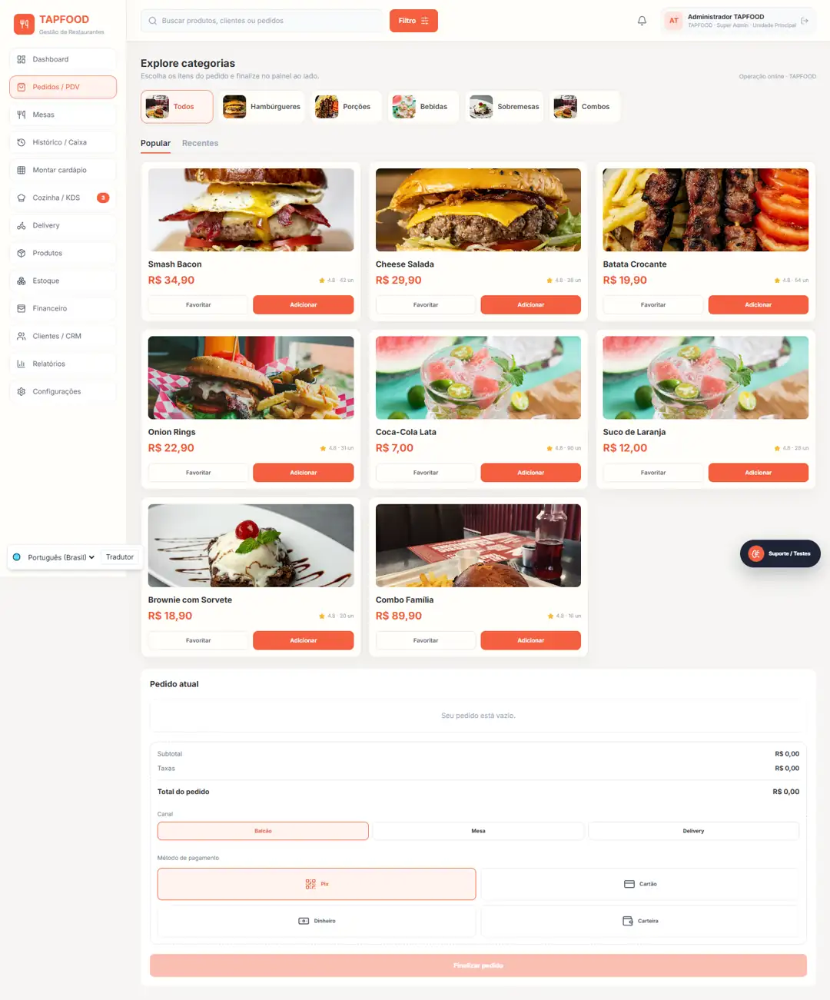
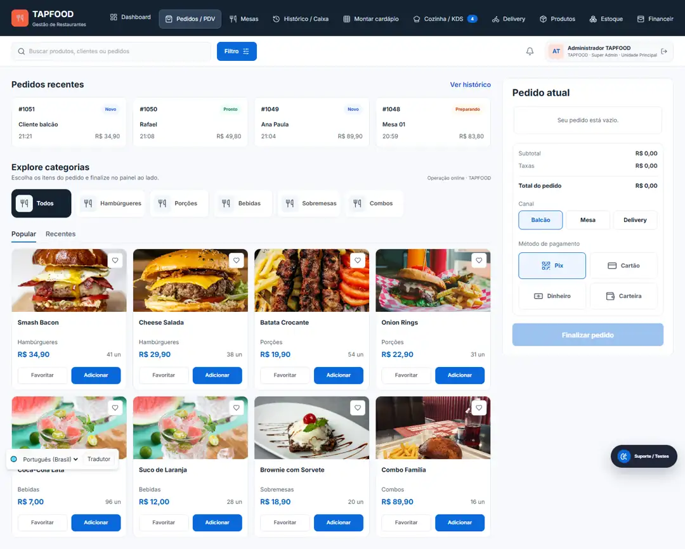
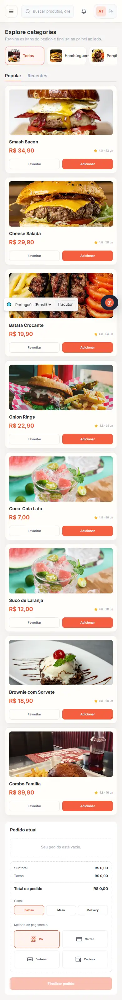
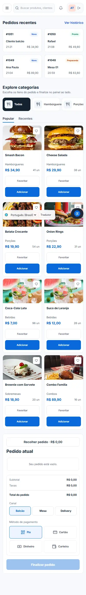

# Redesign visual do PDV — validação

Base: `9ae1e93419b14ecbea03145d76d515dcb3597316` (`main`). Branch de revisão: `feature/redesign-pos-seguro-20261026`. Nenhum merge ou deploy realizado.

## Escopo por arquivo

- `src/MesaApp.tsx`: classes de apresentação do shell administrativo, navegação acessível, fila dos quatro pedidos mais recentes do estado existente, cards compactos, imagem cadastrada com fallback neutro e painel recolhível no mobile. Removida a avaliação fixa 4.8 dos produtos. Handlers, chamadas API, montagem, autenticação e fluxo específico de mesas preservados.
- `src/index.css`: tokens de cores, foco de teclado, cabeçalho horizontal escuro, catálogo adaptativo, painel lateral a partir de 1024px e estilos compartilhados dos módulos administrativos. Navegação extensa continua disponível por rolagem horizontal no desktop e menu no mobile.
- `src/lib/i18n.ts`: apenas novas traduções de apresentação nos oito idiomas existentes; nenhuma chave removida.
- `docs/`: registro de validação e capturas reais da aplicação local.

O diff de implementação é somente visual. Não há alterações em `backend/`, persistência, endpoints, credenciais, variáveis de ambiente, dependências, Dockerfiles ou workflows. Os dados da fila vêm de `props.data.orders`; preços, estoque e fotos cadastradas permanecem do estado/API. Não foram adicionados dados de demonstração ao aplicativo ou à produção.

## Ambiente e comandos

Não existe lockfile versionado no commit base e `npm` não está disponível no PATH deste ambiente. Instalação local com o pnpm fornecido pelo ambiente: `pnpm install --lockfile=false --ignore-scripts`. Nenhum manifesto ou lockfile alterado.

| Verificação | Resultado |
| --- | --- |
| Build frontend no commit base | Passou com `node node_modules/vite/bin/vite.js build --configLoader runner` |
| Build frontend final | Passou com o mesmo comando |
| Build backend | Passou com `node node_modules/typescript/bin/tsc -p tsconfig.backend.json` |
| TypeScript frontend | Passou com `node node_modules/typescript/bin/tsc --noEmit -p tsconfig.json` |
| `button-regression-test.mjs` | Passou: 149 verificações de ações/validações da API |
| `operation-regression-test.mjs` | Passou: ciclo de mesa, visibilidade do cliente, estoque, preços e restrições por perfil |
| `delivery-tracking-test.mjs` | Passou: links, privacidade, GPS, encerramento, motoboy e concorrência |
| `translation-regression-test.mjs` | Passou: autorização, validação, sucesso/falha do provedor com transporte simulado |
| `tenant-isolation-test.mjs` | Passou: isolamento por empresa/unidade, QR assinado e roteamento de pedidos |
| `git diff --check` | Passou |

As suítes foram executadas em diretórios `DATA_DIR` locais independentes, com senhas temporárias aleatórias apenas em memória/ambiente de processo. Não usaram dados, sessões ou serviços de produção. O teste de tradução emite uma mensagem esperada de indisponibilidade ao testar a falha do provedor.

O build padrão encontrou uma restrição de leitura do ambiente Windows ao carregar o config pelo esbuild. A opção oficial `--configLoader runner` permitiu compilar sem modificar o projeto. O modo dev também encontrou varredura do diretório legado `preview-appdeploy` e erros locais de resolução; as capturas usam o build real via Vite Preview. Os avisos preexistentes de `env.js` sem `type=module` e bundle maior que 500kB permanecem.

No navegador, passaram as ações de adicionar, aumentar/diminuir quantidade, remover, desabilitar finalização com carrinho vazio, finalizar um pedido local com confirmação de sucesso, recolher/expandir o painel mobile e trocar para inglês. Foram abertas as telas de dashboard, mesas, histórico/caixa, cardápio, KDS, delivery, produtos, estoque, financeiro, clientes, relatórios e configurações sem erros JavaScript. Isso verifica navegação e renderização, não todos os processos de cada módulo; nenhuma homologação operacional completa desses módulos é alegada.

Também passaram os estados de busca sem resultados, carregamento e erro de conexão. O teste reteve a resposta de estado e retornou uma falha HTTP controlada apenas no navegador local; a aplicação exibiu sua mensagem de erro existente. Não houve alteração no tratamento de erros.

## Evidências visuais

Capturas do navegador Chrome, renderizando o aplicativo real e seu backend local com a base inicial de testes do próprio repositório. Não são mockups nem fotografias de produção. Não comprovam o estado do serviço publicado. Tamanhos: 1920, 1440, 1366, 1280, 1024, 768, 390 e 360px; altura de viewport 1000px, captura da página inteira. Comparativo base/final sem overflow horizontal da página e sem erros JavaScript nas capturas.

| Antes (commit base) | Depois |
| --- | --- |
|  |  |
|  |  |

## Limitações e revisão necessária

- Operações reais de impressão física, pagamentos externos, GPS em dispositivo móvel e integrações externas não foram acionadas. Testes de backend não substituem homologação desses serviços.
- Não houve acesso autenticado ao EasyPanel nem à base de produção; configuração efetiva e saúde dos serviços publicados não foram comprovadas. README e EASYPANEL foram inspecionados; o workflow documentado publica em push para main.
- O fluxo de mesa mantém sua interface específica. Observações, variantes e descontos não foram inventados onde o PDV atual não os oferece.
- Foco visível e rótulos acessíveis foram melhorados; não há certificação de acessibilidade nem auditoria completa de contraste de todas as telas.
- Os módulos compartilham o shell e as cores; esta entrega não reescreve seus formulários nem a lógica operacional. O suporte de tradução preexistente continua parcial fora dos novos textos.

## Rollback

Enquanto o PR não for mesclado, basta fechá-lo: main permanece no estado anterior. Se houver merge autorizado posteriormente, reverter o commit de merge/commit do redesign por um novo PR. Não usar reset forçado de main. Nenhuma restauração de banco ou migration é necessária, pois não houve mudança de dados ou esquema. Se uma publicação futura falhar, republicar o artefato anterior correspondente ao SHA base após verificar o histórico efetivamente publicado.
